# David Cannan's Developer Journey

## 👋 Connect with Cdaprod

  

    
    
    
    
    
  

---

**🎥 [This project](https://github.com/Cdaprod/live-streaming-setup) is part of my content creation tech stack! Watch me build and use it on [YouTube](https://youtube.com/@Cdaprod)**

This streaming setup powers my tech content creation across various platforms. From coding sessions to tech reviews, this is the backbone of my live streaming infrastructure. Want to see it in action? Check out my:

  

    <a href="https://youtube.com/@Cdaprod">📺 YouTube Channel</a> - Live coding and tech tutorials 
    <a href="https://twitter.com/cdasmktcda">🐦 Twitter</a> - Daily tech insights and updates 
    <a href="https://sanity.cdaprod.dev">📝 Blog</a> - In-depth articles and guides 
    <a href="https://www.linkedin.com/in/cdasmkt">💼 LinkedIn</a> - Professional updates 
    <a href="https://twitch.tv/cdaproductions">🎮 Twitch</a> - Live coding sessions
  

  <h3>🚀 Support My Work</h3>
  

    
    
  

  
  
<em>Building cool stuff for developers and content creators!</em>

---

  
Built with ❤️ by <a href="https://github.com/Cdaprod">Cdaprod</a>

  
<em>🎬 "Because every stream deserves to be awesome!"</em>

# 🎉 Welcome to My GitHub Profile!

  

    I'm <strong>David Cannan</strong>, a passionate DevOps Engineer, AI Developer, and Stoic Philosopher dedicated to building robust AI solutions, cloud-native applications, and scalable infrastructures. I currently focus my efforts on building Full Stack Solutions and implementing Infrastructure as Code (IaC) with advanced custom full-stack solutions, AI tooling, services, and middleware in secure hybrid cloud environments. This README provides an overview of my projects, technical expertise, personal journey, and the methods I use to style and deploy my GitHub Pages site for an enhanced visual and interactive experience.
  

---

## 🚀 Quick Links

  
  
  
  
  

---

  

---

  
  

---

  

  

  

  
☝️ I wrote this SVG in text, so links are kinda finicky. 😅

---

  <h1>📚 Personal Introduction</h1>
  
  <h2>Basic Information</h2>
  
<strong>Name:</strong> David Cannan

  
<strong>Profession/Role:</strong> Full Stack Software Engineer, AI Infrastructure and Solutions Architect, and Stoic Philosopher

  
<strong>Location:</strong> Douglasville, Georgia, USA

  <h3>Professional Summary</h3>
  

    I am a dedicated DevOps professional, AI enthusiast, and thought leader in the integration of object storage and AI systems. With a unique background that blends self-taught skills in software engineering, hacking, and cloud technologies, my current focus is on building AI-driven solutions that bridge the gap between data storage and intelligent applications.
  

  <h2>Extended Backstory</h2>

  <h4>Early Years and Education</h4>
  

    My early years were marked by significant challenges that shaped my unconventional path. Born and raised with an affinity for technology and problem-solving, I faced personal struggles in my early adulthood, including battling addiction and navigating the complexities of life on the streets. Despite these hurdles, my resilience and self-determination led me to become a self-taught engineer, constantly driven by the need to reinvent myself and create a better future for my family.
  

  <h4>Career Path</h4>
  

    My career began in the shadows of unconventional work, but I transformed my life through relentless learning and a passion for technology. I started by hacking my way into understanding software, cloud infrastructures, and DevOps principles. My journey took a professional turn when I joined MinIO, gaining hands-on experience with cutting-edge cloud storage technologies and contributing to the development of AI-integrated data solutions. My expertise lies in creating modular, scalable systems that leverage AI, data lakes, and object storage.
  

  <h4>Challenges and Growth</h4>
  

    My path was not without significant obstacles. Overcoming addiction and a chaotic lifestyle required profound personal growth and a shift in mindset. These experiences instilled in me a deep sense of discipline, persistence, and a commitment to honesty--values that now guide both my personal and professional life. My journey has taught me the importance of resilience, the power of self-reinvention, and the ability to find strength in vulnerability.
  

  <h4>Turning Points</h4>
  

    A pivotal moment in my life was the realization that my past did not define me but instead equipped me with unique skills and perspectives. Choosing to channel my experiences into a career in technology, I embraced my role as a father to triplets and dedicated myself to learning new skills. My decision to pursue DevOps and AI development marked a significant turning point, transforming past adversity into fuel for future success.
  

  <h3>Key Achievements</h3>
  <ul>
    <li>Overcame addiction and transformed from a chaotic lifestyle to a focused, skilled professional in the tech industry.</li>
    <li>Secured a role at MinIO, contributing to innovative AI and cloud storage solutions.</li>
    <li>Built a personal brand as an AI and DevOps expert, with a focus on creating practical, scalable systems.</li>
  </ul>

  <h3>Personal Philosophy</h3>
  

    My life is guided by stoic principles, emphasizing self-control, resilience, and the pursuit of wisdom. I believe in the power of personal accountability and the importance of living authentically. My approach to life is centered around the idea that true strength comes from facing one’s vulnerabilities and using them as a source of power rather than a point of weakness.
  

  <h3>Areas of Expertise</h3>
  <ol>
    <li>DevOps and Cloud Infrastructure</li>
    <li>AI Integration with Data Storage Solutions</li>
    <li>Stoic Philosophy and Personal Resilience</li>
  </ol>

  <h3>Current Projects/Goals</h3>
  

    I am currently focused on building personal AI solutions that integrate object storage and intelligent data processing. I am also working on establishing my brand as a thought leader in the AI and DevOps space, aiming to create content that educates and inspires others to overcome their own challenges.
  

  <h3>Vision for the Future</h3>
  

    I envision a future where technology, particularly AI, is used to empower individuals and organizations. My goal is to develop AI-driven systems that make data more accessible, manageable, and insightful. Long-term, I aim to establish a startup that bridges the gap between object storage and AI, creating innovative solutions that benefit both developers and enterprises.
  

  <h3>How I Can Help</h3>
  

    I offer a unique perspective on integrating AI with existing technologies, providing insights that are both practical and transformative. I am open to collaborations that focus on pushing the boundaries of AI and cloud technology while maintaining a commitment to ethical and stoic principles.
  

  <h3>Interesting Facts</h3>
  <ul>
    <li>I am a single father to triplets, balancing my professional ambitions with my role as a dedicated dad.</li>
    <li>I have never worked a traditional 9-to-5 job, instead forging my path through self-taught skills and determination.</li>
    <li>Despite my non-traditional background, I have become a respected voice in the tech community, known for my honesty and resilience.</li>
  </ul>

  <h3>Contact Information</h3>
  
Email: <a href="mailto:cdaprod@cdaprod.dev">cdaprod@cdaprod.dev</a>

  
LinkedIn: <a href="https://linkedin.com/in/cdasmkt">David Cannan</a>

  
Personal Website: <a href="https://Sanity.Cdaprod.dev">Sanity.Cdaprod.dev</a>

---

## 📚 Publications

### Selected MinIO Articles

1. **[Building and Deploying a MinIO-Powered LangChain Agent API with LangServe](https://blog.min.io/minio-powered-langchain-agent-with-langserve/)**
2. **[Dynamic ETL Pipeline: Hydrate AI with Web Data for MinIO and Weaviate using Unstructured-IO](https://blog.min.io/minio-weaviate-unstructured-io/)**
3. **[Disaster Proof MinIO with GitOps](https://blog.min.io/disaster-proof-minio-with-gitops/)**
4. **[Optimizing AI Data Processing with MinIO Weaviate and Langchain in Retrieval Augmented Generation (RAG) Pipelines](https://blog.min.io/optimizing-ai-data-processing-with-minio-weaviate-and-langchain-in-retrieval-augmented-generation-rag-pipelines/)**
5. **[The Future of Hybrid Cloud Pipelines: Integrating MinIO, Tailscale, and GitHub Actions](https://blog.min.io/the-future-of-hybrid-cloud-pipelines-integrating-minio-tailscale-and-github-actions/)**
6. **[Deploying Application Infrastructure with MinIO S3 and Tailscale VPN](https://blog.min.io/deploying-application-infrastructure-minio-tailscale-vpn/)**

---

## 📈 Current Focus

- **Advancing Cloud Storage**: Enhancing efficiency and scalability.
- **Creating Innovative AI Tools**: Leveraging OpenAI API for diverse applications.
- **Enhancing Development Workflows**: Through containerization, IaC, and CI/CD pipelines.
- **Exploring Electrical Engineering & IoT**: Integrating IoT devices with hybrid cloud solutions.
- **AI Automation**: Implementing AI-driven processes for enhanced efficiency.
- **Research & Development**: Pursuing innovative ideas and exploring new technologies.

---

## 🌱 Learning & Growth

- **Advanced AI & ML Techniques**: Exploring reinforcement learning, NLP, and computer vision.
- **Cloud-Native Technologies**: Focusing on Kubernetes, microservices, and serverless computing.
- **Software Architecture**: Learning domain-driven design and event-driven architecture.
- **IoT and Hybrid Cloud**: Working with MQTT, edge computing, and hybrid cloud architectures.

---

## 🚀 Current Focus

I am deeply engrossed in:

- **Advancing MinIO's cloud storage capabilities**: Focusing on efficiency and scalability.
- **Creating innovative personal AI tools**: Leveraging the OpenAI API for diverse applications.
- **Enhancing development workflows**: Through containerization, Infrastructure as Code (IaC), and robust CI/CD pipelines to optimize efficiency and reliability.
- **Exploring Electrical Engineering & IoT**: Designing and developing smart systems integrating IoT devices with hybrid cloud solutions for automation and control.
- **AI Automation**: Implementing AI-driven processes to enhance efficiency, accuracy, and adaptability across various applications.
- **Research and Exploratory Development**: Pursuing innovative ideas, conducting experiments, and exploring new technologies to stay at the cutting edge of tech advancements.

## 💡 Projects

My GitHub repositories showcase my ventures in:

- **Web Applications**: Crafting dynamic, intuitive interfaces with Python and JavaScript, focusing on user engagement and functionality.
- **Digital Downloads and Custom Bots**: Developing automated solutions and bots that streamline tasks, enhance productivity, and offer unique digital experiences.
- **Data Lake Applications with ML**: Utilizing machine learning to delve into vast datasets, extracting valuable insights and facilitating data-driven decision-making.
- **Electrical Engineering & IoT**: Designing and developing smart systems integrating IoT devices with hybrid cloud solutions for automation and control.
- **AI Automation**: Implementing AI-driven processes to enhance efficiency, accuracy, and adaptability across various applications.
- **Research and Exploratory Development**: Pursuing innovative ideas, conducting experiments, and exploring new technologies to stay at the cutting edge of tech advancements.

## 🛠 Skills & Technologies

My technical toolkit includes:

- **Languages**: Mastery in Python, JavaScript, Go, and Bash, enabling versatile software development.
- **DevOps Tools**: Proficient with GitHub Actions, Docker, Kubernetes, and Terraform for seamless development and deployment.
- **Cloud Platforms**: Skilled in deploying and managing applications on AWS, GCP, and Azure, ensuring high availability and performance.
- **Cyber Security & Bug Bounty Hunting**: Dedicated to securing digital environments, applying rigorous methodologies to identify and mitigate vulnerabilities.
- **Electrical Engineering**: Expertise in circuit design, PCB layout, and integrating hardware with software for IoT and automation projects.

## 🌱 Learning & Growth

My journey of exploration and enhancement focuses on:

- **Advanced AI & ML Techniques**: Pursuing deeper knowledge in AI and ML to build more intelligent and adaptive applications. I'm currently exploring reinforcement learning, natural language processing, and computer vision to develop cutting-edge AI solutions. Resources I use include:
  - [Deep Learning Specialization by Andrew Ng](https://www.coursera.org/specializations/deep-learning)
  - [Fast.ai Courses](https://www.fast.ai/)
  - [Hands-On Machine Learning with Scikit-Learn, Keras, and TensorFlow by Aurélien Géron](https://www.oreilly.com/library/view/hands-on-machine-learning/9781492032632/)

- **Cloud-Native Technologies**: Embracing the latest in cloud-native solutions to boost the scalability and resilience of cloud services. My focus is on Kubernetes, microservices architecture, and serverless computing. Key resources include:
  - [Kubernetes Documentation](https://kubernetes.io/docs/)
  - [The Twelve-Factor App](https://12factor.net/)
  - [AWS Lambda Getting Started](https://aws.amazon.com/lambda/getting-started/)

- **Software Architecture**: Committing to the design of robust, scalable, and maintainable software architectures that stand the test of time. I'm learning about domain-driven design, event-driven architecture, and microservices. Essential readings are:
  - [Domain-Driven Design by Eric Evans](https://www.oreilly.com/library/view/domain-driven-design-tackling/0321125215/)
  - [Building Microservices by Sam Newman](https://www.oreilly.com/library/view/building-microservices/9781491950340/)
  - [Designing Data-Intensive Applications by Martin Kleppmann](https://dataintensive.net/)

- **IoT and Hybrid Cloud**: Integrating IoT devices with cloud platforms to create hybrid solutions that offer enhanced capabilities and scalability. I'm currently working with MQTT, edge computing, and hybrid cloud architectures. Useful resources include:
  - [MQTT Essentials](https://www.hivemq.com/mqtt-essentials/)
  - [Edge Computing: A Primer](https://www.ibm.com/cloud/learn/edge-computing)
  - [Azure IoT Hub Documentation](https://docs.microsoft.com/en-us/azure/iot-hub/)

## 📈 Passive Income Goals

My aspirations for generating passive income include:

- **Software Development**: Innovating and developing software solutions that solve real-world problems, providing continuous value. Some of my current projects involve building SaaS applications, developing custom APIs, and creating automation tools. Resources I often reference are:
  - [SaaS Boilerplate](https://saas-boilerplate.dev/)
  - [API Design Patterns by JJ Geewax](https://www.oreilly.com/library/view/api-design-patterns/9781617295850/)
  - [Automate the Boring Stuff with Python by Al Sweigart](https://automatetheboringstuff.com/)

- **Content Creation**: Sharing insights, tutorials, and experiences through my [blog](https://Sanity.Cdaprod.dev) to educate and inspire others.

## ✍️ Selected MinIO Articles

Here are some of my top articles on MinIO:

1. [**Building and Deploying a MinIO-Powered LangChain Agent API with LangServe**](https://blog.min.io/minio-powered-langchain-agent-with-langserve/)  
   Explore the exciting possibilities of leveraging MinIO and LangChain to create a robust and efficient agent capable of handling complex data processing tasks.

2. [**Dynamic ETL Pipeline: Hydrate AI with Web Data for MinIO and Weaviate using Unstructured-IO**](https://blog.min.io/minio-weaviate-unstructured-io/)  
   This article explores the integration of Unstructured-IO, MinIO, and Weaviate to create a dynamic ETL pipeline. This pipeline transforms unstructured web data into structured, analyzable formats, leveraging AI and metadata capabilities to unlock actionable insights.

3. [**Disaster Proof MinIO with GitOps**](https://blog.min.io/disaster-proof-minio-with-gitops/)  
   Learn how strategic automation, redundancy, and integration with Docker and GitHub ensure swift recovery from disasters, transforming potential chaos into a choreographed comeback.

4. [**Optimizing AI Data Processing with MinIO Weaviate and Langchain in Retrieval Augmented Generation (RAG) Pipelines**](https://blog.min.io/optimizing-ai-data-processing-with-minio-weaviate-and-langchain-in-retrieval-augmented-generation-rag-pipelines/)  
   Delve into AI’s next frontier with MinIO S3 Object-Store and SDK, enhancing a Weaviate Retrieval Augmented Generation (RAG) Pipeline for robust data management. Discover how to elevate efficiency in AI systems using LangChain, unlocking new dimensions in scalable AI solutions.

5. [**The Future of Hybrid Cloud Pipelines: Integrating MinIO, Tailscale, and GitHub Actions**](https://blog.min.io/the-future-of-hybrid-cloud-pipelines-integrating-minio-tailscale-and-github-actions/)  
   Streamline your data processing capabilities, ensuring high-quality data management and secure operations. This integration not only enhances workflow automation but also leverages the advanced functionalities of MinIO and Tailscale, providing a powerful solution for modern data processing needs.

6. [**Deploying Application Infrastructure with MinIO S3 and Tailscale VPN**](https://blog.min.io/deploying-application-infrastructure-minio-tailscale-vpn/)  
   Learn how MinIO S3 object storage and Tailscale VPN simplify deploying secure and scalable application infrastructure. This blog covers how their integration offers secure networking, streamlined access, and advanced features to serve hosted applications with Tailscale.

## Publication Index

Here is a complete index of my work related to MinIO. Click on the links to read the articles and dive deeper into each topic.

| No. | Title | Summary | Date | Link |
|-----|-------|---------|------|------|
| 16 | The Future of Hybrid Cloud Pipelines: Integrating MinIO, Tailscale, and GitHub Actions | Streamline your data processing capabilities, ensuring high-quality data management and secure operations. This integration not only enhances workflow automation but also leverages the advanced functionalities of MinIO and Tailscale, providing a powerful solution for modern data processing needs. | 2024-05-24 | [Link](https://blog.min.io/the-future-of-hybrid-cloud-pipelines-integrating-minio-tailscale-and-github-actions/) |
| 15 | Deploying Application Infrastructure with MinIO S3 and Tailscale VPN | Learn how MinIO S3 object storage and Tailscale VPN simplify deploying secure and scalable application infrastructure. This blog covers how their integration offers secure networking, streamlined access, and advanced features to serve hosted applications with Tailscale. | 2024-05-10 | [Link](https://blog.min.io/deploying-application-infrastructure-minio-tailscale-vpn/) |
| 14 | Optimizing AI Data Processing with MinIO Weaviate and Langchain in Retrieval Augmented Generation (RAG) Pipelines | Delve into AI’s next frontier with MinIO S3 Object-Store and SDK, enhancing a Weaviate Retrieval Augmented Generation (RAG) Pipeline for robust data management. Discover how to elevate efficiency in AI systems using LangChain, unlocking new dimensions in scalable AI solutions. | 2024-04-29 | [Link](https://blog.min.io/optimizing-ai-data-processing-with-minio-weaviate-and-langchain-in-retrieval-augmented-generation-rag-pipelines/) |
| 13 | Building and Deploying a MinIO-Powered LangChain Agent API with LangServe | Explore the exciting possibilities of leveraging MinIO and LangChain to create a robust and efficient agent capable of handling complex data processing tasks. | 2024-04-09 | [Link](https://blog.min.io/minio-powered-langchain-agent-with-langserve/) |
| 12 | MinIO Networking with Overlay Networks | Overlay networks enable seamless multi-host deployments for MinIO’s cloud-native S3-compatible storage solutions. Emphasizing security, scalability, and robust container networking, these technologies streamline complex cloud architectures. | 2024-03-29 | [Link](https://blog.min.io/minio-networking-with-overlay-networks/) |
| 11 | Disaster Proof MinIO with GitOps | When disaster strikes, the power of GitOps shines, transforming potential chaos into a choreographed comeback. Learn how strategic automation, redundancy, and Docker and GitHub integration ensure swift recovery, turning system wipes into minor setbacks. | 2024-03-19 | [Link](https://blog.min.io/disaster-proof-minio-with-gitops/) |
| 10 | Powering AI/ML Innovation: Building Feature Stores with MinIO’s High-Performance Object Storage | MinIO’s high-performance object storage is key for AI innovation, offering scalability and integration for feature stores. Its capabilities enable seamless ML workflows, enhancing data management for AI development and deployment, impacting sectors like e-commerce and healthcare. | 2024-03-12 | [Link](https://blog.min.io/minio-feature-store-foundation/) |
| 9 | Deploying MinIO with GitOps on Self-Hosted Infrastructure | This article unveils the synergy between MinIO and GitOps, utilizing self-hosted GitHub Actions to redefine CI/CD workflows. It emphasizes streamlined data management, security, and the efficiency of deploying scalable software. | 2024-03-05 | [Link](https://blog.min.io/minio-self-hosted-gitops/) |
| 8 | Dynamic ETL Pipeline: Hydrate AI with Web Data for MinIO and Weaviate using Unstructured-IO | Unstructured-IO, MinIO, & Weaviate redefine ETL, turning unstructured web data into actionable insights. This collaboration enhances data management, offering a robust solution for dynamic data transformation and analysis, marking a leap in how we process and leverage web-generated content. | 2024-02-27 | [Link](https://blog.min.io/minio-weaviate-unstructured-io/) |
| 7 | Developing Langchain Agents with the MinIO SDK for LLM Tool-Use | Explore Langchain’s LLM Tool-Use and leverage Langgraph for monitoring MinIO’s S3 Object Store. This guide walks you through developing custom conversational AI agents and creating powerful OpenAI LLM chains for efficient data management and enhanced application functionality. | 2024-02-20 | [Link](https://blog.min.io/minio-langchain-tool/) |
| 6 | Powering AI/ML workflows with GitOps Automation | Explore the fusion of GitOps, MinIO, Weaviate, and Python in AI development for unparalleled automation and innovation. This combination offers a solid foundation for creating scalable, efficient, and automated AI solutions, propelling projects from concept to reality with ease. | 2024-02-13 | [Link](https://blog.min.io/minio-weaviate-python-gitops/) |
| 5 | Backing Up Weaviate with MinIO S3 Buckets | Explore integrating MinIO with Weaviate using Docker Compose for AI-enhanced data management. Learn to back up Weaviate to MinIO S3 buckets, ensuring data integrity and scalability with practical Docker and Python examples. Streamline your AI-driven search and analysis with this robust setup. | 2024-02-06 | [Link](https://blog.min.io/minio-weaviate-integration/) |
| 4 | Innovating S3 Bucket Retrieval: Langchain Community S3 Loaders with OpenAI API | Explore the synergy of MinIO, Langchain, and OpenAI in enhancing data storage and processing. This article illustrates MinIO’s integration for efficient document summarization using Langchain and OpenAI’s GPT, revolutionizing AI and ML data handling. | 2024-01-30 | [Link](https://blog.min.io/langchain-openai-s3-loader/) |
| 3 | Event-Driven Architecture: MinIO Event Notification Webhooks using Flask | Explore deploying MinIO and Flask with Docker-compose for event-driven architecture. Master MinIO bucket events and Flask webhooks for efficient data workflows and robust applications. Dive into the synergy of cloud technologies. | 2024-01-23 | [Link](https://blog.min.io/minio-webhook-event-notifications/) |
| 2 | Streamlining Data Events with MinIO and PostgreSQL | Explore 'Streamlining Data Events with MinIO and PostgreSQL,' a guide for developers using Docker, MinIO, and PostgreSQL. Learn about using Docker Compose for real-time data events, enhancing data analytics, and developing robust, event-driven applications. | 2024-01-16 | [Link](https://blog.min.io/minio-postgres-event-notifications/) |
| 1 | Smooth Sailing from Docker to Localhost | Explore the integration of Dockerized MinIO with localhost Flask apps. This guide addresses Docker networking challenges, ensuring seamless MinIO and Flask communication for a development environment that closely mirrors production. Dive into practical solutions for robust workflows. | 2023-12-08 | [Link](https://blog.min.io/from-docker-to-localhost/) |

## Technical Stack and Tools

In my articles, I frequently discuss and use the following tools and technologies:

- **Tailscale**: Hybrid-cloud secure self hosted infrastructure
- **MinIO**: Kubernetes-native S3 object storage
- **Docker**: Containerization platform
- **GitOps**: Automation and CI/CD practices
- **Weaviate**: Vector databases and stores
- **LangChain/Langgraph OpenAI**: Leveraging AI for enhanced data processing

## Contributions and Contact

I'm always open to collaborations and contributions. If you're interested in contributing to this repository or have suggestions for topics, please feel free to [open an issue](https://github.com/cdaprod/david-cannan-minio-blogs/issues) or submit a pull request.

For direct contact, you can reach me via:

- **LinkedIn**: [David Cannan](https://linkedin.com/in/cdasmkt)
- **Email**: cdaprod@cdaprod.dev

## Updates and Maintenance

This repository is updated regularly as new publications are released. Check back often for the latest articles and insights.

## Acknowledgments

Special thanks to all my colleagues at MinIO and the tech community for their support and insights that have significantly influenced this work.

## 🤝 Connect With Me

I'm eager to connect, collaborate, or simply chat about technology, programming, or any topic of mutual interest:

- **Twitter**: [@cdasmktcda](https://twitter.com/cdasmktcda)
- **LinkedIn**: [David Cannan](https://www.linkedin.com/in/cdasmkt/)
- **GitHub**: [Cdaprod](https://github.com/Cdaprod)

Thank you for exploring my profile! Let's dive into my projects and work together on creating something extraordinary.

---

*Crafted with dedication and caffeine by David.*

 
  Visitor count 
  

